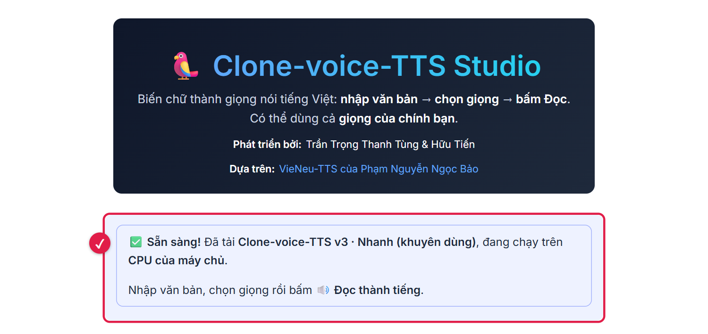
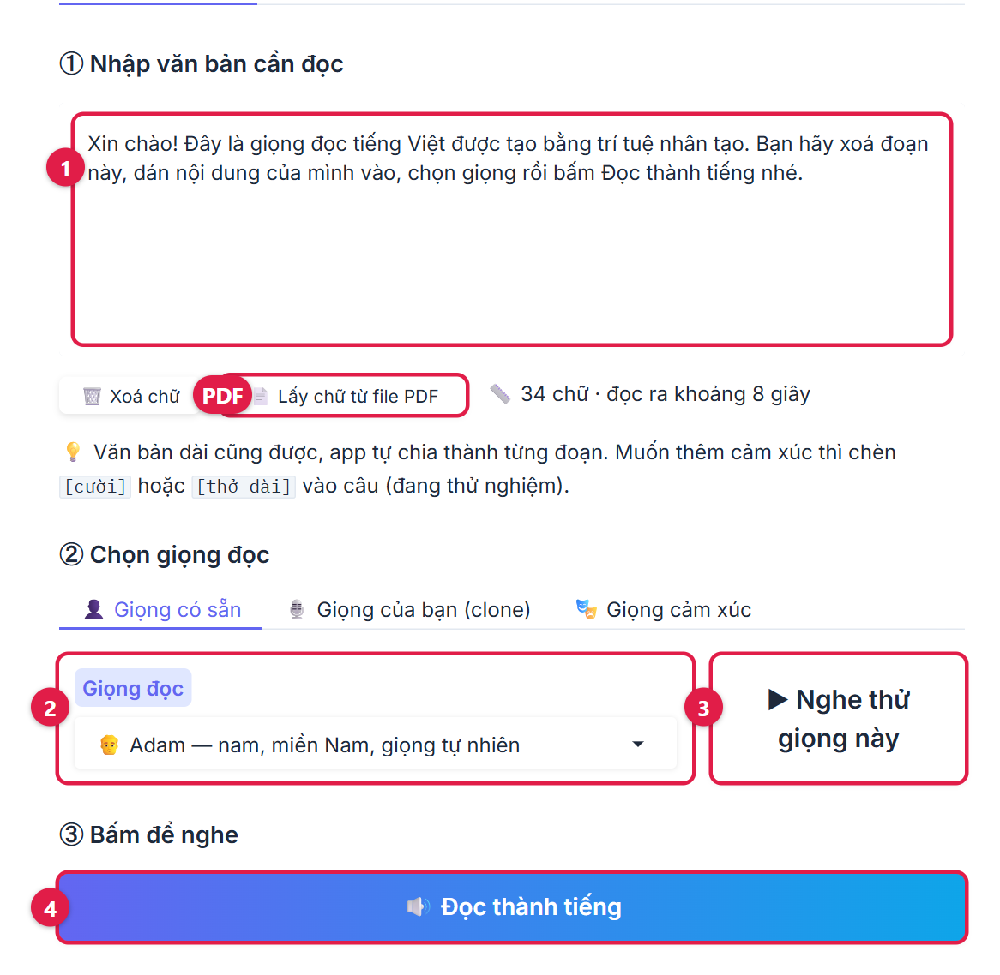
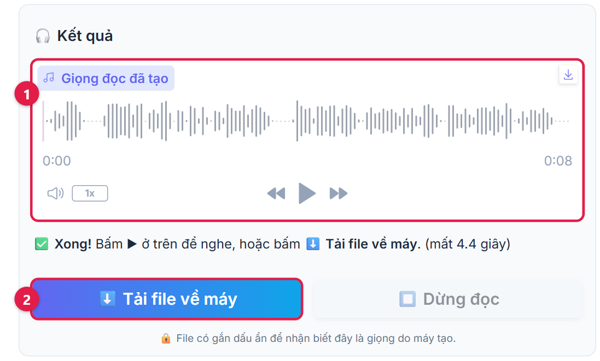
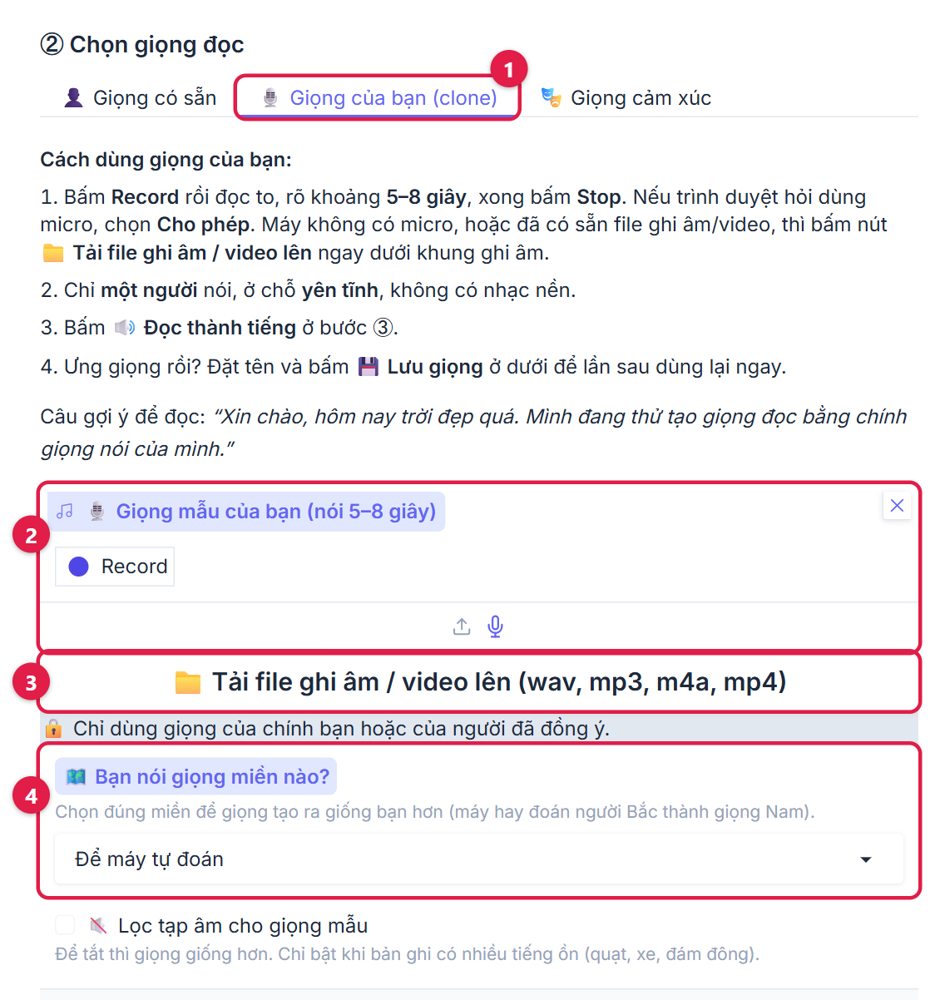
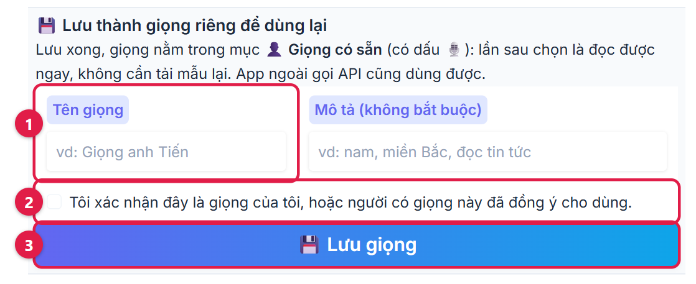
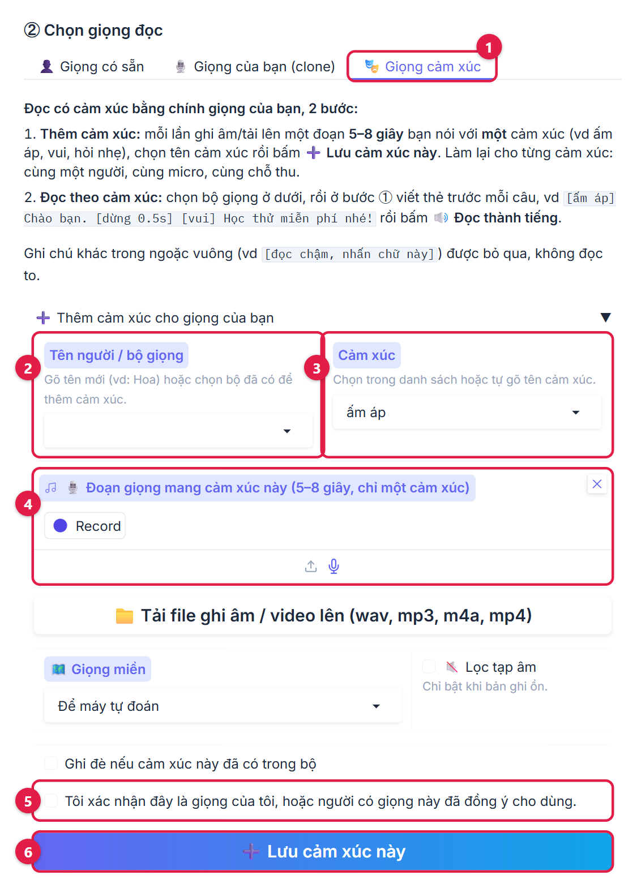
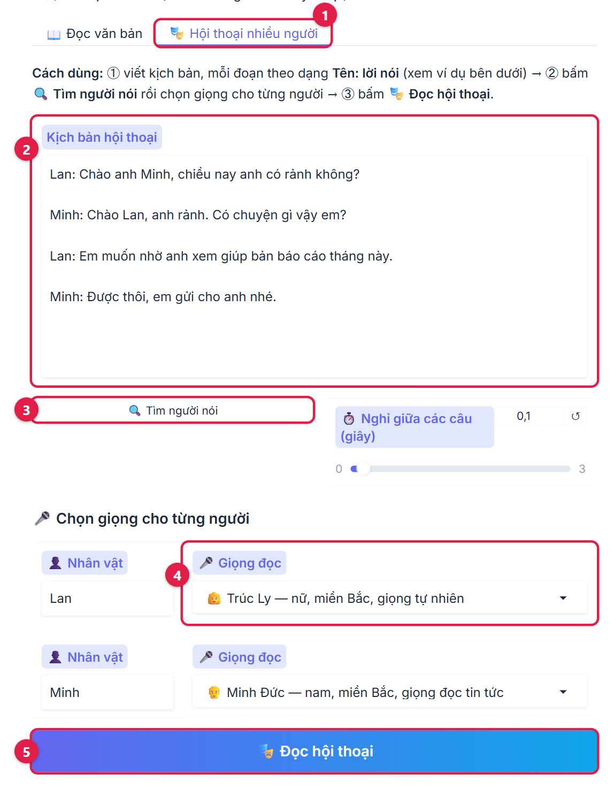

# Hướng dẫn cài và dùng Clone-voice-TTS

Clone-voice-TTS đọc chữ thành giọng nói tiếng Việt và clone được giọng của chính bạn, ngay trên máy tính của bạn.
Bạn không cần biết code: Claude cài giúp, bạn chỉ bấm cho phép và chờ.

## Bạn cần có

- **Máy tính:** Windows 10/11 (chip Intel hoặc AMD; máy chip Snapdragon chưa dùng được), hoặc Mac chip Apple (M1 trở lên)
  chạy macOS 14 trở lên. RAM từ 8 GB, ổ cứng trống khoảng 5 GB, có Internet.
- **Claude:** ứng dụng Claude trên máy tính, tài khoản gói **Pro trở lên**. Tải tại [claude.com/download](https://claude.com/download).

Không biết máy mình có đủ không? Cài Claude xong, hỏi Claude: `Máy mình chip gì, RAM bao nhiêu, ổ cứng còn trống bao nhiêu?`

> [!IMPORTANT]
> Claude gói miễn phí, và Claude mở trên trình duyệt hay điện thoại, **không** cài được phần mềm lên máy bạn.

## Bước 1. Nhờ Claude cài (lần đầu khoảng 10–20 phút)

1. **Tạo một thư mục trống** tên `Clone-voice-TTS`, ngoài Documents và Desktop (hai chỗ này hay bị OneDrive, iCloud đồng bộ):
   - Windows: mở **This PC** → ổ **C:** → chuột phải vào chỗ trống → **New** → **Folder**.
   - Mac: mở **Finder** → menu **Go** → **Home** → chuột phải → **New Folder**.
2. **Mở Claude**, bấm **Code** ở trên cùng thanh bên (cạnh Chat và Cowork).
3. **Ở hàng nút ngay dưới ô chat:**
   - Nút đầu tiên: chọn mục trên cùng trong nhóm **Local** (máy của bạn). Đừng chọn Cloud.
   - Nút thư mục bên cạnh: bấm **Open folder…** rồi chọn thư mục vừa tạo.
   - Ô chế độ quyền: chọn **Manual** (bản cũ ghi **Ask permissions**).
4. **Copy đoạn dưới đây** (bấm nút sao chép ở góc khung), dán vào ô chat rồi bấm Enter. Đoạn này viết cho Claude đọc,
   bạn không cần hiểu.

   ```text
   Mình không biết code. Hãy cài và mở giúp mình phần mềm đọc giọng Clone-voice-TTS:
   https://github.com/huutien1904/clone-voice

   1. Tải (clone) repo vào thẳng thư mục này, không tạo thư mục con (máy chưa có Git thì cài giúp mình).
   2. Tải xong, đọc file CLAUDE.md trong thư mục này và làm đúng theo đó.
   3. Chạy xong thì mở trang web cho mình và nói ngắn gọn mình cần bấm gì.
   Gặp lỗi thì tự sửa, chỉ hỏi mình khi cần mình bấm cho phép.
   ```

5. **Bấm cho phép mỗi khi Claude hỏi** (nút thường ghi **Allow** hoặc **Yes**). Đó là các bước cài bình thường, bạn không
   cần hiểu lệnh. Claude dừng lại chờ bạn bấm, nên cứ vài phút xem lại cửa sổ Claude.
   - Windows hiện hộp hỏi quyền (có khi chỉ nhấp nháy ở thanh Taskbar): bấm **Yes**.
   - Claude hỏi điều bạn không hiểu: trả lời `Mình không rành, bạn chọn cách an toàn và phổ biến nhất rồi làm tiếp giúp mình.`
   - Claude nhờ mở lại ứng dụng: thoát hẳn Claude, mở lại, bấm cuộc trò chuyện cũ ở thanh bên rồi gõ `tiếp tục`.
6. **Xong, trang web tự mở** (trong trình duyệt hoặc ngay trong Claude). Không thấy thì bấm link `http://127.0.0.1:7860`
   mà Claude gửi: đó là địa chỉ riêng trên máy bạn, người khác không vào được. Lần đầu, trang có thể hiện
   **⏳ Đang chuẩn bị giọng đọc...** vài phút. Thấy khung **Sẵn sàng!** như ảnh dưới là dùng được
   ("máy chủ" ở đây chính là máy tính của bạn).



Lần đầu này, phần mềm chạy bên trong Claude: cứ để Claude mở (thu nhỏ cũng được); tắt Claude là phần mềm tắt theo.

## Bước 2. Đọc văn bản



1. Bấm **Xoá chữ** để xoá chữ mẫu, rồi dán chữ của bạn vào ô **1**. Có file PDF thì bấm **Lấy chữ từ file PDF** (chỗ đánh
   dấu **PDF**); PDF dạng ảnh scan thì không lấy được chữ.
2. Chọn giọng ở ô **2**. Bấm **3** để nghe thử giọng đó.
3. Bấm **4** (**Đọc thành tiếng**).



Nghe ở khung **1**. Bấm **2** (**Tải file về máy**): file MP3 nằm trong thư mục **Downloads (Tải xuống)** của máy.

## Bước 3. Clone giọng của bạn



1. Bấm tab **1** (**Giọng của bạn (clone)**).
2. Bấm **Record** ở khung **2**, nói to, rõ 5–8 giây rồi bấm **Stop**. Trình duyệt hỏi dùng micro thì bấm **Cho phép (Allow)**;
   lỡ bấm chặn thì bấm biểu tượng ổ khoá cạnh địa chỉ trang, bật lại micro rồi tải lại trang.
   Đã có sẵn file ghi âm hoặc video thì bấm **3** để tải lên.
3. Ô **4**: chọn **Miền Bắc** hoặc **Miền Nam** đúng giọng bạn; giọng miền Trung hoặc không chắc thì để **Để máy tự đoán**.
4. Bấm **Đọc thành tiếng** (nút **4** ở Bước 2) để nghe giọng clone đọc chữ ở ô 1.

Mẹo: chỉ một người nói, chỗ yên tĩnh, không có nhạc nền. Bản ghi có tiếng ồn mới bật **Lọc tạp âm cho giọng mẫu**.

Nghe ưng thì lưu lại để lần sau dùng ngay:



Đặt tên ở ô **1**, tích ô xác nhận **2**, bấm **3** (**Lưu giọng**). Lần sau giọng này nằm trong tab **Giọng có sẵn**,
có dấu 🎙️ phía trước.

## Thêm (không bắt buộc)

### Đọc có cảm xúc



1. Bấm tab **1** (**Giọng cảm xúc**).
2. Gõ tên bộ giọng ở ô **2** (ví dụ tên bạn), chọn cảm xúc ở ô **3**.
3. Ghi 5–8 giây nói đúng cảm xúc đó ở khung **4**, tích ô xác nhận **5**, bấm **6** (**Lưu cảm xúc này**).
   Làm lại cho từng cảm xúc, giữ nguyên tên bộ giọng, cùng một micro.
4. Kéo xuống mục **Đọc theo cảm xúc**, chọn bộ giọng vừa lưu, bấm **Điền văn bản mẫu có thẻ cảm xúc vào bước ①**,
   sửa lời rồi bấm **Đọc thành tiếng**. Thẻ có dạng `[vui] Chào bạn. [dừng 0.5s]`; nếu tự gõ dấu `[ ]` mà ra chữ ơ, ư thì
   tạm tắt bộ gõ tiếng Việt khi gõ dấu ngoặc.

### Hội thoại nhiều người



Bấm tab **1**, viết kịch bản ở ô **2** theo dạng `Tên: lời nói`, bấm **3** (**Tìm người nói**), chọn giọng cho từng người
ở **4**, rồi bấm **5** (**Đọc hội thoại**).

## Lần sau mở lại

- **Bấm đúp biểu tượng Clone-voice-TTS trên Desktop.** Sau lần cài đầu, Claude thường đề nghị tạo biểu tượng này (không
  thấy thì gõ câu ở bảng dưới). Bấm đúp sẽ mở một cửa sổ chạy nhiều chữ tiếng Anh (Windows: cửa sổ đen; Mac: Terminal):
  đó là phần mềm đang chạy, không phải lỗi. Khoảng một phút sau web tự mở. Đóng cửa sổ đó là tắt phần mềm.
- **Hoặc nhờ Claude:** mở Claude, bấm **Code**, bấm cuộc trò chuyện cũ ở thanh bên (hoặc tạo phiên mới: **Local**,
  **Open folder…**, chọn thư mục `Clone-voice-TTS`), rồi gõ `Mở Clone-voice-TTS cho mình.`

## Câu hay dùng với Claude

Gõ trong Claude, mục **Code**, **Local**, đúng thư mục đã cài:

| Bạn muốn | Gõ vào Claude |
| --- | --- |
| Mở phần mềm | Mở Clone-voice-TTS cho mình. |
| Tạo biểu tượng bấm đúp | Tạo biểu tượng Clone-voice-TTS trên Desktop theo CLAUDE.md. |
| Tắt phần mềm | Tắt Clone-voice-TTS giúp mình. |
| Cập nhật bản mới (giọng đã lưu không mất) | Cập nhật Clone-voice-TTS lên bản mới nhất từ GitHub theo CLAUDE.md. |
| Sao lưu giọng đã lưu | Sao lưu các giọng đã lưu của Clone-voice-TTS ra Desktop. |
| Khôi phục giọng trên máy mới | Khôi phục các giọng trong file sao lưu trên Desktop vào Clone-voice-TTS. |

## Gặp lỗi

Chụp màn hình (Windows: **Windows + Shift + S**; Mac: **Cmd + Ctrl + Shift + 4**), bấm vào ô chat của Claude, bấm
**Ctrl + V** (Mac: **Cmd + V**) để dán ảnh, rồi gõ **sửa giúp mình**. Một số trường hợp hay gặp:

| Hiện tượng | Cách xử lý |
| --- | --- |
| Bấm **Code** thì hiện lời mời nâng cấp | Tài khoản đang ở gói miễn phí: nâng lên gói Pro rồi thử lại. |
| **Code** đòi kết nối GitHub hoặc chọn repository | Bạn đang dùng Claude trên trình duyệt/điện thoại, hoặc đã chọn Cloud. Dùng ứng dụng trên máy tính và chọn **Local**. |
| Bị đòi đăng nhập lại, hoặc báo lỗi 403 | Đăng xuất rồi đăng nhập lại, thoát hẳn Claude rồi mở lại. |
| Không mở được trang web | Phần mềm đã tắt (do đóng Claude hoặc cửa sổ đen): bấm đúp biểu tượng, hoặc gõ `Mở Clone-voice-TTS cho mình.` |
| Claude báo hết lượt dùng (usage limit) | Chờ đến giờ Claude ghi, rồi gõ `Làm tiếp phần cài Clone-voice-TTS.` |
| Tải file video hoặc m4a lên báo thiếu ffmpeg | Gõ `Cài ffmpeg cho Clone-voice-TTS.` |
| Web chậm hoặc báo thiếu bộ nhớ | Đóng bớt Chrome và phần mềm khác, rồi nhờ Claude mở lại. |
| Giọng clone chưa giống | Ghi lại đoạn 5–8 giây, một người nói, chỗ yên tĩnh; chọn đúng giọng miền. |

## Lưu ý

- Chỉ clone giọng của bạn, hoặc của người đã đồng ý cho bạn dùng. Khi đăng hoặc gửi file giọng clone, nên ghi rõ đây là
  giọng do máy tạo.
- Giọng bạn lưu chỉ nằm trên máy của bạn. Không gõ mật khẩu, số thẻ hay mã OTP vào ô chat của Claude.
- Cần hỗ trợ: [điền kênh hỗ trợ].
